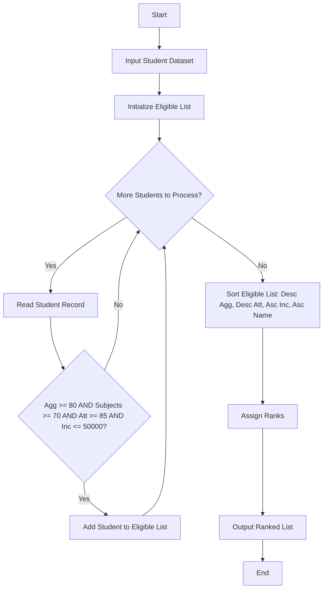

**Problem Statement**
Design a software system to evaluate and rank university scholarship applicants. The system must filter out candidates who do not meet baseline thresholds for aggregate marks (80%), individual subject scores (minimum 70% in each subject), attendance (85%), and annual family income (maximum $50,000). Eligible students are then ranked primarily by aggregate marks in descending order. Any ties are resolved systematically by checking highest attendance, followed by lowest income, and finally alphabetical order of the applicant's name.

**Algorithm**

1. Receive a dataset of student records containing names, aggregate marks, subject-wise scores, attendance percentages, and family incomes.
2. Create an empty list to store eligible candidates.
3. Loop through each student in the dataset.
4. Check if the student's aggregate marks >= 80, all individual subject marks >= 70, attendance >= 85, and income <= 50000.
5. If all criteria are met, append the student to the eligible list.
6. Sort the eligible list using a prioritized multi-level key:
* Aggregate marks (Descending)
* Attendance (Descending)
* Income (Ascending)
* Name (Ascending)


7. Assign ranks based on the final sorted order and output the list.

**Flowchart**



**Python Source Code**

```python
def rank_applicants(students, min_agg, min_sub, min_att, max_inc):
    eligible = []
    for s in students:
        if s['aggregate'] >= min_agg and all(score >= min_sub for score in s['subjects']) and s['attendance'] >= min_att and s['income'] <= max_inc:
            eligible.append(s)
    
    eligible.sort(key=lambda x: (-x['aggregate'], -x['attendance'], x['income'], x['name']))
    return eligible

students_data = [
    {"name": "Alice", "aggregate": 85, "subjects": [75, 80, 85], "attendance": 90, "income": 40000},
    {"name": "Bob", "aggregate": 82, "subjects": [65, 85, 90], "attendance": 88, "income": 35000},
    {"name": "Charlie", "aggregate": 85, "subjects": [80, 80, 85], "attendance": 92, "income": 45000},
    {"name": "David", "aggregate": 85, "subjects": [80, 85, 80], "attendance": 90, "income": 30000},
    {"name": "Eve", "aggregate": 90, "subjects": [90, 90, 90], "attendance": 95, "income": 20000}
]

ranked_students = rank_applicants(students_data, 80, 70, 85, 50000)

for rank, student in enumerate(ranked_students, 1):
    print(f"Rank {rank}: {student['name']} (Agg: {student['aggregate']}, Att: {student['attendance']}, Inc: {student['income']})")

```

**Sample Input**

```json
[
    {"name": "Alice", "aggregate": 85, "subjects": [75, 80, 85], "attendance": 90, "income": 40000},
    {"name": "Bob", "aggregate": 82, "subjects": [65, 85, 90], "attendance": 88, "income": 35000},
    {"name": "Charlie", "aggregate": 85, "subjects": [80, 80, 85], "attendance": 92, "income": 45000},
    {"name": "David", "aggregate": 85, "subjects": [80, 85, 80], "attendance": 90, "income": 30000},
    {"name": "Eve", "aggregate": 90, "subjects": [90, 90, 90], "attendance": 95, "income": 20000}
]

```

**Sample Output**

```text
Rank 1: Eve (Agg: 90, Att: 95, Inc: 20000)
Rank 2: Charlie (Agg: 85, Att: 92, Inc: 45000)
Rank 3: David (Agg: 85, Att: 90, Inc: 30000)
Rank 4: Alice (Agg: 85, Att: 90, Inc: 40000)

```
