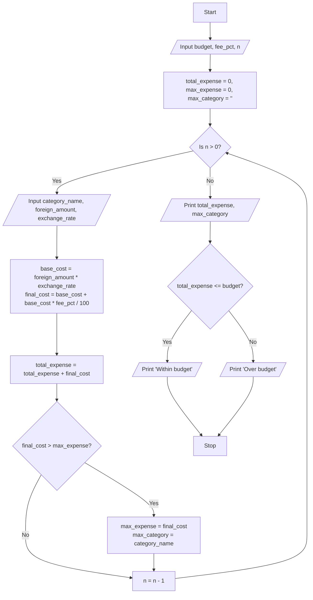

**Problem Statement**
Write a program to perform a multi-currency travel budget analysis. The program must accept a total budget in a base currency, a conversion fee percentage, and multiple expense entries containing a category name, foreign currency amount, and exchange rate. It should calculate the total expense in the base currency including the conversion fee, identify the category with the highest expense, and evaluate whether the total spending is within the planned budget.

**Algorithm**

1. Start.
2. Read the `budget` and the `fee_percentage`.
3. Read the number of expense categories, `n`.
4. Initialize `total_expense = 0`, `max_expense = 0`, and `max_category = ""`.
5. Repeat `n` times:
a. Read `category_name`, `foreign_amount`, and `exchange_rate`.
b. Calculate `base_cost = foreign_amount * exchange_rate`.
c. Calculate `final_cost = base_cost + (base_cost * (fee_percentage / 100))`.
d. Add `final_cost` to `total_expense`.
e. If `final_cost > max_expense`, update `max_expense = final_cost` and `max_category = category_name`.
6. Print the `total_expense` and the `max_category`.
7. If `total_expense <= budget`, print "Within budget". Otherwise, print "Over budget".
8. Stop.

**Flowchart**



**Python Source Code**

```python
budget = float(input("Enter total budget (Base Currency): "))
fee_pct = float(input("Enter conversion fee percentage: "))
n = int(input("Enter number of expense categories: "))

total_expense = 0.0
max_expense = 0.0
max_category = ""

for _ in range(n):
    cat = input("Enter category name: ")
    amount = float(input(f"Enter amount for {cat} (Foreign Currency): "))
    rate = float(input(f"Enter exchange rate (Base per Foreign) for {cat}: "))
    
    base_cost = amount * rate
    final_cost = base_cost + (base_cost * (fee_pct / 100))
    total_expense += final_cost
    
    if final_cost > max_expense:
        max_expense = final_cost
        max_category = cat

print(f"\nTotal Expense: {total_expense:.2f}")
print(f"Largest Expense Category: {max_category} ({max_expense:.2f})")

if total_expense <= budget:
    print("Status: Within budget")
else:
    print("Status: Over budget")

```

**Sample Input**

```text
Enter total budget (Base Currency): 5000
Enter conversion fee percentage: 2
Enter number of expense categories: 3
Enter category name: Flight
Enter amount for Flight (Foreign Currency): 1000
Enter exchange rate (Base per Foreign) for Flight: 1.2
Enter category name: Hotel
Enter amount for Hotel (Foreign Currency): 2000
Enter exchange rate (Base per Foreign) for Hotel: 1.1
Enter category name: Food
Enter amount for Food (Foreign Currency): 500
Enter exchange rate (Base per Foreign) for Food: 1.5

```

**Sample Output**

```text
Total Expense: 4233.00
Largest Expense Category: Hotel (2244.00)
Status: Within budget

```
