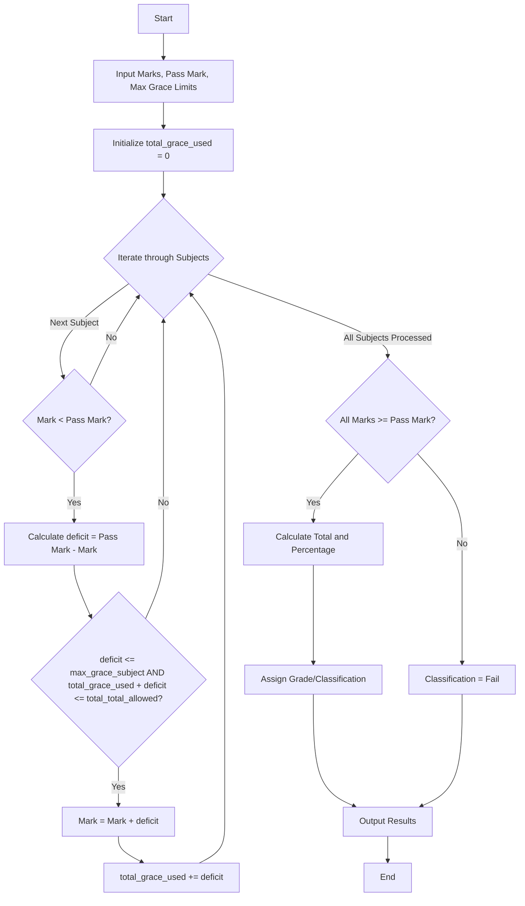

## Problem Statement
Design a system to process student marks across multiple subjects by applying a minimum pass mark criterion and a predefined grace-mark policy. The system must evaluate failing marks, apply grace marks if the deficit is within the per-subject and overall allowed limits, ensure maximum marks are not exceeded, and output the finalized marks, total score, percentage, and academic classification.

**Algorithm**

1. Read the list of subject marks, maximum marks per subject, minimum pass mark, maximum grace marks allowed per subject, and total grace marks allowed.
2. Initialize `total_grace_used` to 0.
3. Iterate through each mark in the marks list.
4. If a mark is less than the pass mark, calculate `deficit = pass mark - mark`.
5. If `deficit` is less than or equal to the maximum grace marks per subject AND `total_grace_used + deficit` is less than or equal to total grace marks allowed:
a. Add `deficit` to the current mark.
b. Add `deficit` to `total_grace_used`.
6. Check if all updated marks are greater than or equal to the pass mark.
7. If all marks meet the pass criteria, calculate total marks and percentage, and assign a classification (Distinction >= 75%, First Class >= 60%, Second Class >= 50%, Pass >= Pass threshold).
8. If any mark is still below the pass criteria, assign the classification as "Fail".
9. Output the updated marks, total marks, percentage, and classification.

**Flowchart**



**Python Source Code**

```python
def process_results(marks, max_marks, pass_marks, max_grace_subject, total_grace_allowed):
    total_grace_used = 0
    updated_marks = list(marks)
    
    for i in range(len(updated_marks)):
        if updated_marks[i] < pass_marks:
            deficit = pass_marks - updated_marks[i]
            if deficit <= max_grace_subject and (total_grace_used + deficit) <= total_grace_allowed:
                updated_marks[i] += deficit
                total_grace_used += deficit
                
    passed = all(mark >= pass_marks for mark in updated_marks)
    total = sum(updated_marks)
    percentage = (total / (max_marks * len(marks))) * 100
    
    if passed:
        if percentage >= 75:
            classification = "Distinction"
        elif percentage >= 60:
            classification = "First Class"
        elif percentage >= 50:
            classification = "Second Class"
        else:
            classification = "Pass"
    else:
        classification = "Fail"
        
    return updated_marks, total, percentage, classification

marks = [62, 38, 55, 70, 37]
max_marks = 100
pass_marks = 40
max_grace_subject = 5
total_grace_allowed = 10

final_marks, total_score, percent, result = process_results(
    marks, max_marks, pass_marks, max_grace_subject, total_grace_allowed
)

print(f"Final Marks: {final_marks}")
print(f"Total Marks: {total_score}")
print(f"Percentage: {percent:.2f}%")
print(f"Classification: {result}")

```

**Sample Input**
Subject Marks: `[62, 38, 55, 70, 37]`
Max Marks Per Subject: `100`
Pass Mark: `40`
Max Grace Marks Per Subject: `5`
Total Grace Marks Allowed: `10`

**Sample Output**
Final Marks: `[62, 40, 55, 70, 40]`
Total Marks: `267`
Percentage: `53.40%`
Classification: `Second Class`
