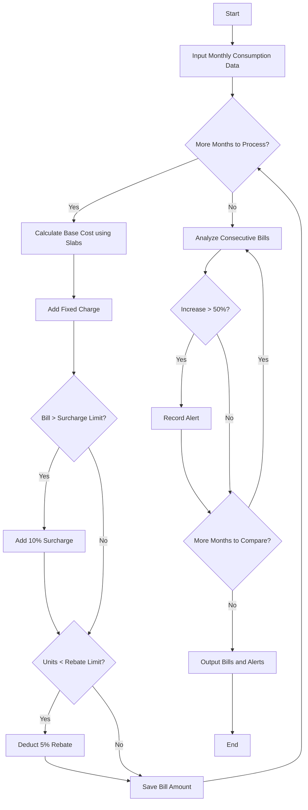

**Problem Statement**
Design a progressive electricity billing system that calculates monthly household bills based on tiered consumption slabs, fixed charges, surcharges for high bills, and rebates for low consumption. The system must process consumption data across consecutive months, compute the exact bill for each, and identify and flag any month where the bill increases by more than 50% compared to the preceding month, indicating an unusual consumption spike.

**Algorithm**

1. Define base parameters: consumption slabs (0-100, 101-300, >300), rate per slab, fixed charge, surcharge threshold, and rebate conditions.
2. Initialize an empty list to store computed monthly bills.
3. For each month's recorded unit consumption:
a. Compute the base cost by applying the respective tiered slab rates.
b. Add the standard fixed charge to the base cost.
c. If the total exceeds the surcharge threshold, add a percentage surcharge.
d. If the units consumed are below the rebate threshold, apply a percentage deduction.
e. Store the final calculated bill alongside the month name.
4. Iterate through the generated list of bills starting from the second month.
5. Calculate the percentage change in the bill amount compared to the previous month.
6. If the percentage increase is strictly greater than 50%, generate a warning alert for that month.
7. Output all monthly bill amounts and any generated unusual increase alerts.

**Flowchart**



**Python Source Code**

```python
def calculate_bill(units):
    bill = 0
    if units <= 100:
        bill = units * 1.5
    elif units <= 300:
        bill = (100 * 1.5) + ((units - 100) * 2.5)
    else:
        bill = (100 * 1.5) + (200 * 2.5) + ((units - 300) * 4.0)
    
    bill += 10
    
    if bill > 100:
        bill += bill * 0.10
        
    if units < 100:
        bill -= bill * 0.05
        
    return round(bill, 2)

def analyze_bills(monthly_consumption):
    bills = []
    for month, units in monthly_consumption.items():
        bills.append({"month": month, "units": units, "bill": calculate_bill(units)})
    
    alerts = []
    for i in range(1, len(bills)):
        prev_bill = bills[i-1]["bill"]
        curr_bill = bills[i]["bill"]
        if prev_bill > 0:
            increase = ((curr_bill - prev_bill) / prev_bill) * 100
            if increase > 50:
                alerts.append(f"Unusual increase of {increase:.1f}% detected from {bills[i-1]['month']} to {bills[i]['month']}.")
    
    return bills, alerts

monthly_data = {
    "January": 80,
    "February": 120,
    "March": 130,
    "April": 310,
    "May": 150
}

bills, alerts = analyze_bills(monthly_data)

for b in bills:
    print(f"{b['month']}: Units = {b['units']}, Total Bill = ${b['bill']}")

for alert in alerts:
    print(alert)

```

**Sample Input**

```json
{
    "January": 80,
    "February": 120,
    "March": 130,
    "April": 310,
    "May": 150
}

```

**Sample Output**

```text
January: Units = 80, Total Bill = $135.85
February: Units = 120, Total Bill = $231.0
March: Units = 130, Total Bill = $258.5
April: Units = 310, Total Bill = $770.0
May: Units = 150, Total Bill = $313.5
Unusual increase of 70.0% detected from January to February.
Unusual increase of 197.9% detected from March to April.

```
