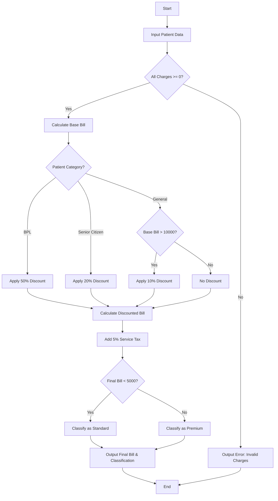

**Problem Statement**
Design a hospital billing system that calculates the final payable amount for patients based on their consultation, diagnostic, and treatment charges. The system must validate that all charges are non-negative, apply conditional concessions based on the patient's category (BPL, Senior Citizen, or General), add a standard service tax, and classify the patient's billing tier (Standard or Premium) based on the final computed bill amount.

**Algorithm**

1. Read patient details including name, category, and individual charges (consultation, diagnostic, treatment).
2. Validate that all charges are greater than or equal to zero. If any charge is negative, flag an error for the patient and halt their processing.
3. Calculate the base bill by summing the consultation, diagnostic, and treatment charges.
4. Apply the payment policy concessions:
* If category is "BPL", apply a 50% discount.
* If category is "Senior Citizen", apply a 20% discount.
* If category is "General" and the base bill is greater than 10000, apply a 10% discount.
* Otherwise, apply no discount.


5. Subtract the discount from the base bill to find the discounted bill.
6. Add a 5% service tax to the discounted bill to determine the final bill.
7. Classify the patient: if the final bill is strictly less than 5000, classify as "Standard"; otherwise, classify as "Premium".
8. Output the patient's final bill and classification.

**Flowchart**



**Python Source Code**

```python
def process_billing(patient):
    name = patient.get("name")
    category = patient.get("category")
    consultation = patient.get("consultation", 0)
    diagnostic = patient.get("diagnostic", 0)
    treatment = patient.get("treatment", 0)
    
    if consultation < 0 or diagnostic < 0 or treatment < 0:
        return {"name": name, "error": "Invalid charges. Must be non-negative."}
    
    base_bill = consultation + diagnostic + treatment
    discount = 0.0
    
    if category == "BPL":
        discount = base_bill * 0.50
    elif category == "Senior Citizen":
        discount = base_bill * 0.20
    elif category == "General" and base_bill > 10000:
        discount = base_bill * 0.10
        
    discounted_bill = base_bill - discount
    final_bill = discounted_bill + (discounted_bill * 0.05)
    
    if final_bill < 5000:
        classification = "Standard"
    else:
        classification = "Premium"
        
    return {
        "name": name,
        "base_bill": base_bill,
        "discount": discount,
        "final_bill": round(final_bill, 2),
        "classification": classification
    }

patients = [
    {"name": "John Doe", "category": "General", "consultation": 500, "diagnostic": 1500, "treatment": 2000},
    {"name": "Jane Smith", "category": "Senior Citizen", "consultation": 800, "diagnostic": 2000, "treatment": 5000},
    {"name": "Mark Twain", "category": "BPL", "consultation": 300, "diagnostic": 500, "treatment": 1000},
    {"name": "Alan Turing", "category": "General", "consultation": 1000, "diagnostic": 4000, "treatment": 6000},
    {"name": "Grace Hopper", "category": "General", "consultation": -100, "diagnostic": 500, "treatment": 500}
]

for p in patients:
    result = process_billing(p)
    if "error" in result:
        print(f"Patient: {result['name']} | Error: {result['error']}")
    else:
        print(f"Patient: {result['name']} | Final Bill: ${result['final_bill']} | Classification: {result['classification']}")

```

**Sample Input**

```json
[
    {"name": "John Doe", "category": "General", "consultation": 500, "diagnostic": 1500, "treatment": 2000},
    {"name": "Jane Smith", "category": "Senior Citizen", "consultation": 800, "diagnostic": 2000, "treatment": 5000},
    {"name": "Mark Twain", "category": "BPL", "consultation": 300, "diagnostic": 500, "treatment": 1000},
    {"name": "Alan Turing", "category": "General", "consultation": 1000, "diagnostic": 4000, "treatment": 6000},
    {"name": "Grace Hopper", "category": "General", "consultation": -100, "diagnostic": 500, "treatment": 500}
]

```

**Sample Output**

```text
Patient: John Doe | Final Bill: $4200.0 | Classification: Standard
Patient: Jane Smith | Final Bill: $6552.0 | Classification: Premium
Patient: Mark Twain | Final Bill: $945.0 | Classification: Standard
Patient: Alan Turing | Final Bill: $10395.0 | Classification: Premium
Patient: Grace Hopper | Error: Invalid charges. Must be non-negative.

```
