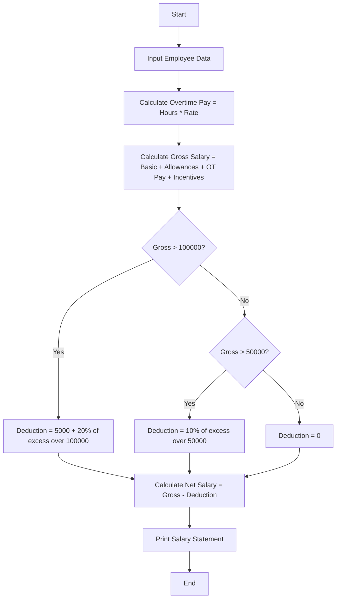

**Problem Statement**
Design an employee payroll system that calculates an employee's gross salary by summing basic pay, standard allowances, overtime pay, and performance incentives. The system must then apply a progressive deduction (tax) policy based on the gross salary slabs. Finally, it must generate a structured salary statement detailing the gross earnings, total deductions, and the final net salary.

**Algorithm**

1. Read the employee data including name, employee ID, basic pay, allowances, overtime hours, overtime rate, and incentives.
2. Calculate the total overtime pay by multiplying overtime hours by the overtime rate.
3. Calculate the gross salary by adding basic pay, allowances, overtime pay, and incentives.
4. Calculate deductions based on progressive slabs:
* If gross salary is 50,000 or less, deduction is 0.
* If gross salary is between 50,001 and 100,000, deduction is 10% of the amount exceeding 50,000.
* If gross salary is above 100,000, deduction is 10% of 50,000 plus 20% of the amount exceeding 100,000.


5. Calculate the net salary by subtracting the total deductions from the gross salary.
6. Generate and output the formatted salary statement containing all calculated components.

**Flowchart**



**Python Source Code**

```python
def generate_payroll(employees):
    statements = []
    
    for emp in employees:
        ot_pay = emp['ot_hours'] * emp['ot_rate']
        gross_salary = emp['basic'] + emp['allowances'] + ot_pay + emp['incentives']
        
        deductions = 0
        if gross_salary > 100000:
            deductions = (50000 * 0.10) + ((gross_salary - 100000) * 0.20)
        elif gross_salary > 50000:
            deductions = (gross_salary - 50000) * 0.10
            
        net_salary = gross_salary - deductions
        
        statements.append({
            "emp_id": emp['emp_id'],
            "name": emp['name'],
            "gross": round(gross_salary, 2),
            "deductions": round(deductions, 2),
            "net": round(net_salary, 2)
        })
        
    return statements

employees_data = [
    {"emp_id": "E101", "name": "Alice", "basic": 40000, "allowances": 8000, "ot_hours": 10, "ot_rate": 200, "incentives": 0},
    {"emp_id": "E102", "name": "Bob", "basic": 60000, "allowances": 15000, "ot_hours": 5, "ot_rate": 300, "incentives": 5000},
    {"emp_id": "E103", "name": "Charlie", "basic": 90000, "allowances": 20000, "ot_hours": 20, "ot_rate": 500, "incentives": 15000},
    {"emp_id": "E104", "name": "Diana", "basic": 30000, "allowances": 5000, "ot_hours": 0, "ot_rate": 0, "incentives": 2000}
]

payroll_statements = generate_payroll(employees_data)

for stmt in payroll_statements:
    print(f"ID: {stmt['emp_id']} | Name: {stmt['name']}")
    print(f"Gross Salary: ${stmt['gross']} | Deductions: ${stmt['deductions']} | Net Salary: ${stmt['net']}")
    print("-" * 50)

```

**Sample Input**

```json
[
    {"emp_id": "E101", "name": "Alice", "basic": 40000, "allowances": 8000, "ot_hours": 10, "ot_rate": 200, "incentives": 0},
    {"emp_id": "E102", "name": "Bob", "basic": 60000, "allowances": 15000, "ot_hours": 5, "ot_rate": 300, "incentives": 5000},
    {"emp_id": "E103", "name": "Charlie", "basic": 90000, "allowances": 20000, "ot_hours": 20, "ot_rate": 500, "incentives": 15000},
    {"emp_id": "E104", "name": "Diana", "basic": 30000, "allowances": 5000, "ot_hours": 0, "ot_rate": 0, "incentives": 2000}
]

```

**Sample Output**

```text
ID: E101 | Name: Alice
Gross Salary: $50000 | Deductions: $0 | Net Salary: $50000
--------------------------------------------------
ID: E102 | Name: Bob
Gross Salary: $81500 | Deductions: $3150.0 | Net Salary: $78350.0
--------------------------------------------------
ID: E103 | Name: Charlie
Gross Salary: $135000 | Deductions: $12000.0 | Net Salary: $123000.0
--------------------------------------------------
ID: E104 | Name: Diana
Gross Salary: $37000 | Deductions: $0 | Net Salary: $37000
--------------------------------------------------

```
