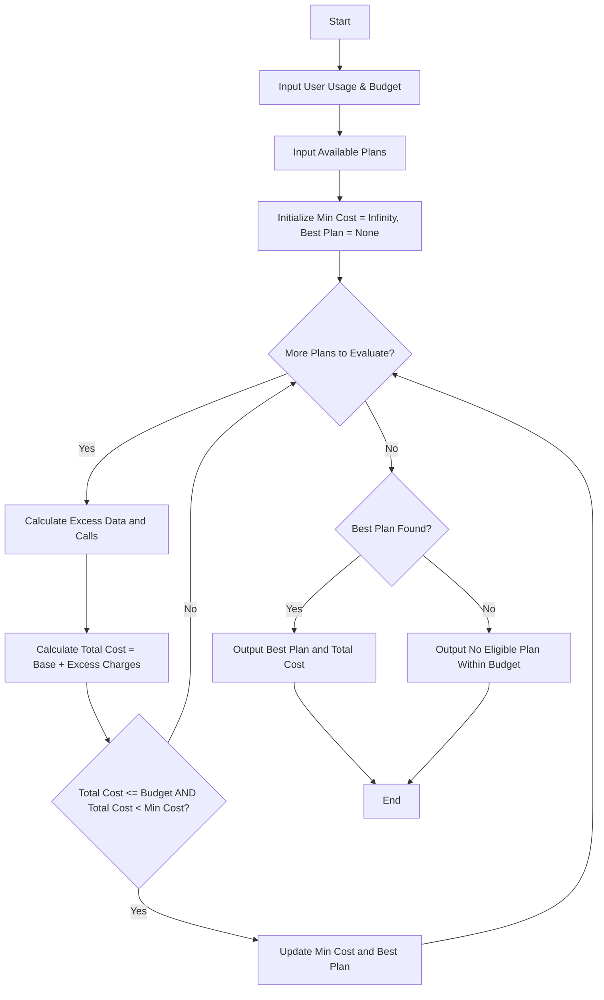

**Problem Statement**
Design a telecommunications cost optimization system that evaluates various mobile plans against a user's specific monthly usage requirements (data and voice calls) and a maximum budget constraint. For each plan, the system must calculate any excess usage charges if the user's requirements exceed the plan's base limits. Finally, the system must filter out plans that exceed the budget and identify the single most economical plan among the eligible options.

**Algorithm**

1. Read the user's monthly requirements: required data (GB), required calls (minutes), and maximum budget.
2. Read the list of available mobile plans, where each plan has a base cost, data limit, call limit, excess data rate (per GB), and excess call rate (per minute).
3. Initialize variables to track the best plan name and the minimum calculated cost (set to infinity initially).
4. Iterate through each plan in the available plans list:
a. Calculate excess data by subtracting the plan's data limit from the required data. If the result is negative, set it to 0.
b. Calculate excess calls by subtracting the plan's call limit from the required calls. If the result is negative, set it to 0.
c. Compute the total cost by adding the plan's base cost, (excess data * excess data rate), and (excess calls * excess call rate).
d. Check if the total cost is less than or equal to the user's budget.
e. If it is within budget and the total cost is strictly less than the current minimum cost, update the minimum cost and store the plan's name as the best plan.
5. After evaluating all plans, output the most economical plan and its total cost. If no plan satisfies the budget, output a failure message.

**Flowchart**



**Python Source Code**

```python
def find_best_plan(req_data, req_calls, budget, plans):
    best_plan = None
    min_cost = float('inf')
    
    for plan in plans:
        excess_data = max(0, req_data - plan['data_limit'])
        excess_calls = max(0, req_calls - plan['call_limit'])
        
        excess_data_cost = excess_data * plan['data_rate']
        excess_call_cost = excess_calls * plan['call_rate']
        
        total_cost = plan['cost'] + excess_data_cost + excess_call_cost
        
        if total_cost <= budget and total_cost < min_cost:
            min_cost = total_cost
            best_plan = plan['name']
            
    if best_plan:
        return {"plan": best_plan, "total_cost": round(min_cost, 2)}
    else:
        return {"error": "No eligible plan found within budget."}

user_req_data = 45
user_req_calls = 600
user_budget = 60.00

available_plans = [
    {"name": "Basic", "cost": 20.0, "data_limit": 15, "call_limit": 300, "data_rate": 1.5, "call_rate": 0.10},
    {"name": "Standard", "cost": 35.0, "data_limit": 40, "call_limit": 500, "data_rate": 1.0, "call_rate": 0.05},
    {"name": "Premium", "cost": 50.0, "data_limit": 100, "call_limit": 1000, "data_rate": 0.5, "call_rate": 0.02},
    {"name": "Data Heavy", "cost": 40.0, "data_limit": 60, "call_limit": 200, "data_rate": 1.0, "call_rate": 0.15}
]

result = find_best_plan(user_req_data, user_req_calls, user_budget, available_plans)

if "error" in result:
    print(result["error"])
else:
    print(f"Most Economical Plan: {result['plan']}")
    print(f"Total Calculated Cost: ${result['total_cost']}")

```

**Sample Input**

```json
user_req_data = 45
user_req_calls = 600
user_budget = 60.00

available_plans = [
    {"name": "Basic", "cost": 20.0, "data_limit": 15, "call_limit": 300, "data_rate": 1.5, "call_rate": 0.10},
    {"name": "Standard", "cost": 35.0, "data_limit": 40, "call_limit": 500, "data_rate": 1.0, "call_rate": 0.05},
    {"name": "Premium", "cost": 50.0, "data_limit": 100, "call_limit": 1000, "data_rate": 0.5, "call_rate": 0.02},
    {"name": "Data Heavy", "cost": 40.0, "data_limit": 60, "call_limit": 200, "data_rate": 1.0, "call_rate": 0.15}
]

```

**Sample Output**

```text
Most Economical Plan: Standard
Total Calculated Cost: $45.0

```
