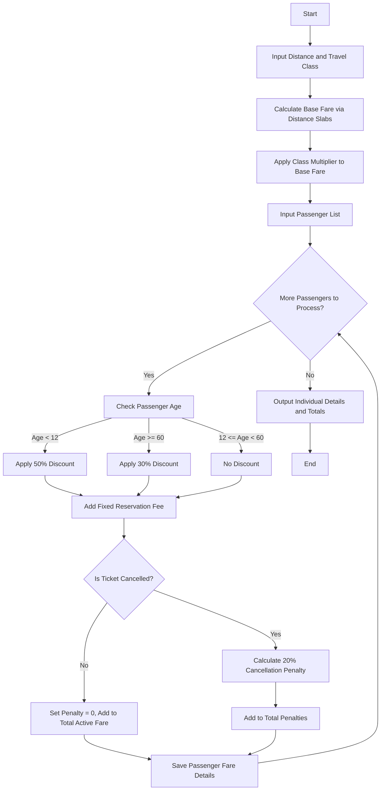

**Problem Statement**
Design a railway fare calculation system that computes the ticket cost for multiple passengers based on the distance traveled, the class of accommodation, age-based concessions, and fixed reservation fees. The system must also calculate the penalty amount for any passengers who cancel their tickets, providing a final breakdown of individual fares, penalties, and the total valid revenue generated from the booking.

**Algorithm**

1. Read the journey details: travel distance (in kilometers) and travel class (e.g., SL, 3A, 2A, 1A).
2. Calculate the base fare using distance slabs:
* 0 to 100 km: $0.50 per km
* 101 to 500 km: $50 + $0.40 per km over 100
* > 500 km: $210 + $0.30 per km over 500


3. Apply the class multiplier to the base fare (e.g., SL = 1, 3A = 2, 2A = 3, 1A = 4) to get the standard class fare.
4. Initialize variables to track the total active fare and total cancellation penalties.
5. For each passenger in the booking:
a. Check the passenger's age to determine concessions:
* If age < 12 (Child): Apply a 50% discount on the standard class fare.
* If age >= 60 (Senior): Apply a 30% discount on the standard class fare.
* Otherwise: No discount.
b. Add a fixed reservation fee to the discounted fare to compute the final ticket fare.
c. Check if the passenger's ticket is marked as cancelled.
d. If cancelled, calculate the cancellation penalty (e.g., 20% of the final ticket fare) and add to total penalties.
e. If not cancelled, add the final ticket fare to the total active fare.
f. Store the individual passenger's final fare and penalty details.


6. Output the detailed ticket breakdown for each passenger and the aggregate booking totals.

**Flowchart**



**Python Source Code**

```python
def calculate_railway_fare(distance, travel_class, passengers):
    if distance <= 100:
        base_fare = distance * 0.50
    elif distance <= 500:
        base_fare = 50 + ((distance - 100) * 0.40)
    else:
        base_fare = 210 + ((distance - 500) * 0.30)
        
    class_multipliers = {"SL": 1, "3A": 2, "2A": 3, "1A": 4}
    multiplier = class_multipliers.get(travel_class, 1)
    class_fare = base_fare * multiplier
    
    reservation_fee = 20
    cancellation_rate = 0.20
    
    results = []
    total_active_fare = 0
    total_penalties = 0
    
    for p in passengers:
        discount = 0
        if p["age"] < 12:
            discount = class_fare * 0.50
        elif p["age"] >= 60:
            discount = class_fare * 0.30
            
        ticket_fare = (class_fare - discount) + reservation_fee
        
        if p.get("cancelled", False):
            penalty = ticket_fare * cancellation_rate
            total_penalties += penalty
            results.append({"name": p["name"], "status": "Cancelled", "fare": 0, "penalty": round(penalty, 2)})
        else:
            total_active_fare += ticket_fare
            results.append({"name": p["name"], "status": "Confirmed", "fare": round(ticket_fare, 2), "penalty": 0})
            
    return results, round(total_active_fare, 2), round(total_penalties, 2)

distance = 650
travel_class = "3A"
passengers_data = [
    {"name": "Alice", "age": 35, "cancelled": False},
    {"name": "Bob", "age": 65, "cancelled": False},
    {"name": "Charlie", "age": 10, "cancelled": False},
    {"name": "David", "age": 40, "cancelled": True}
]

details, total_fare, total_penalty = calculate_railway_fare(distance, travel_class, passengers_data)

for d in details:
    print(f"Passenger: {d['name']} | Status: {d['status']} | Fare: ${d['fare']} | Penalty: ${d['penalty']}")
print("-" * 40)
print(f"Total Active Fare: ${total_fare}")
print(f"Total Penalties Collected: ${total_penalty}")

```

**Sample Input**

```json
distance = 650
travel_class = "3A"
passengers_data = [
    {"name": "Alice", "age": 35, "cancelled": False},
    {"name": "Bob", "age": 65, "cancelled": False},
    {"name": "Charlie", "age": 10, "cancelled": False},
    {"name": "David", "age": 40, "cancelled": True}
]

```

**Sample Output**

```text
Passenger: Alice | Status: Confirmed | Fare: $530.0 | Penalty: $0
Passenger: Bob | Status: Confirmed | Fare: $377.0 | Penalty: $0
Passenger: Charlie | Status: Confirmed | Fare: $275.0 | Penalty: $0
Passenger: David | Status: Cancelled | Fare: $0 | Penalty: $106.0
----------------------------------------
Total Active Fare: $1182.0
Total Penalties Collected: $106.0

```
