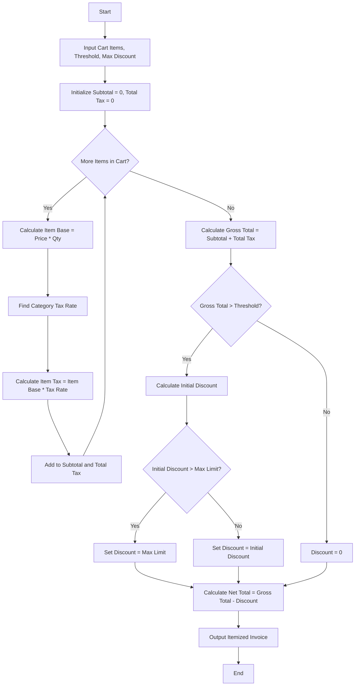

**Problem Statement**
Design a retail billing system that processes a customer's shopping cart containing multiple products across different categories. The system must calculate the base cost, apply category-specific tax rates, and compute the gross total. It should then apply a conditional percentage discount if the gross total exceeds a predefined threshold, subject to a strict maximum concession limit. Finally, it must generate a detailed, itemized invoice.

**Algorithm**

1. Read the list of items in the cart, where each item has a name, category, unit price, and quantity.
2. Initialize variables for `subtotal` and `total_tax` to zero.
3. Define category tax rates (e.g., Electronics: 18%, Clothing: 12%, Grocery: 5%).
4. Iterate through each item in the cart:
a. Calculate the item's base price by multiplying unit price by quantity.
b. Determine the tax rate based on the item's category.
c. Calculate the item's tax amount by multiplying the base price by the tax rate.
d. Add the base price to the `subtotal` and the tax amount to the `total_tax`.
5. Calculate the `gross_total` by adding `subtotal` and `total_tax`.
6. Initialize `discount` to zero.
7. If `gross_total` is greater than the threshold:
a. Calculate the preliminary discount as a percentage of the `gross_total`.
b. If the preliminary discount exceeds the maximum concession limit, set `discount` to the maximum concession limit; otherwise, keep the preliminary discount.
8. Calculate the `net_total` by subtracting the `discount` from the `gross_total`.
9. Generate the itemized invoice detailing individual item costs, total taxes, the applied discount, and the final payable amount.

**Flowchart**



**Python Source Code**

```python
def generate_invoice(cart, threshold, discount_rate, max_concession):
    tax_rates = {
        "Electronics": 0.18,
        "Clothing": 0.12,
        "Grocery": 0.05
    }
    
    subtotal = 0
    total_tax = 0
    itemized_list = []
    
    for item in cart:
        base_price = item["price"] * item["quantity"]
        rate = tax_rates.get(item["category"], 0.0)
        item_tax = base_price * rate
        
        subtotal += base_price
        total_tax += item_tax
        
        itemized_list.append({
            "name": item["name"],
            "base_price": round(base_price, 2),
            "tax": round(item_tax, 2)
        })
        
    gross_total = subtotal + total_tax
    discount = 0
    
    if gross_total > threshold:
        calc_discount = gross_total * discount_rate
        discount = min(calc_discount, max_concession)
        
    net_total = gross_total - discount
    
    return {
        "items": itemized_list,
        "subtotal": round(subtotal, 2),
        "total_tax": round(total_tax, 2),
        "gross_total": round(gross_total, 2),
        "discount": round(discount, 2),
        "net_total": round(net_total, 2)
    }

cart_data = [
    {"name": "Smartphone", "category": "Electronics", "price": 600.0, "quantity": 1},
    {"name": "Jeans", "category": "Clothing", "price": 40.0, "quantity": 2},
    {"name": "Rice", "category": "Grocery", "price": 25.0, "quantity": 4}
]

invoice = generate_invoice(cart_data, 500, 0.10, 50)

print("ITEMIZED INVOICE")
print("-" * 30)
for i in invoice["items"]:
    print(f"{i['name']}: Base = ${i['base_price']}, Tax = ${i['tax']}")
print("-" * 30)
print(f"Subtotal: ${invoice['subtotal']}")
print(f"Total Tax: ${invoice['total_tax']}")
print(f"Gross Total: ${invoice['gross_total']}")
print(f"Discount Applied: -${invoice['discount']}")
print(f"Net Payable: ${invoice['net_total']}")

```

**Sample Input**

```json
cart_data = [
    {"name": "Smartphone", "category": "Electronics", "price": 600.0, "quantity": 1},
    {"name": "Jeans", "category": "Clothing", "price": 40.0, "quantity": 2},
    {"name": "Rice", "category": "Grocery", "price": 25.0, "quantity": 4}
]
threshold = 500
discount_rate = 0.10
max_concession = 50

```

**Sample Output**

```text
ITEMIZED INVOICE
------------------------------
Smartphone: Base = $600.0, Tax = $108.0
Jeans: Base = $80.0, Tax = $9.6
Rice: Base = $100.0, Tax = $5.0
------------------------------
Subtotal: $780.0
Total Tax: $122.6
Gross Total: $902.6
Discount Applied: -$50.0
Net Payable: $852.6

```
