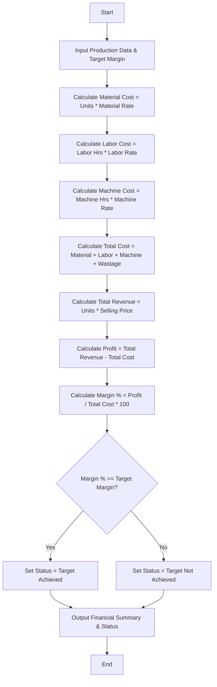

**Problem Statement**
Design a manufacturing analysis system that evaluates the profitability of a production run. The system must calculate the total production cost by aggregating raw material costs, labor charges, machine operational costs, and wastage penalties. It will then compute the total revenue generated from the selling price, determine the net profit or loss, calculate the profit margin percentage, and evaluate whether the production meets a predefined target profit margin.

**Algorithm**

1. Read the input parameters: number of units produced, material cost per unit, labor hours, labor rate, machine hours, machine rate, total wastage cost, selling price per unit, and the target profit margin percentage.
2. Calculate total material cost by multiplying units produced by the material cost per unit.
3. Calculate total labor cost by multiplying labor hours by the labor rate.
4. Calculate total machine cost by multiplying machine hours by the machine rate.
5. Calculate the total production cost by summing the material cost, labor cost, machine cost, and wastage cost.
6. Calculate the total revenue by multiplying the units produced by the selling price per unit.
7. Calculate the net profit (or loss) by subtracting the total production cost from the total revenue.
8. Calculate the actual profit margin percentage as (net profit / total production cost) * 100.
9. Compare the actual profit margin with the target profit margin to determine if the target was met.
10. Output the computed costs, revenue, profit amount, profit margin, and the target evaluation status.

**Flowchart**



**Python Source Code**

```python
def analyze_profitability(data):
    material_cost = data['units'] * data['material_rate']
    labor_cost = data['labor_hours'] * data['labor_rate']
    machine_cost = data['machine_hours'] * data['machine_rate']
    
    total_cost = material_cost + labor_cost + machine_cost + data['wastage_cost']
    total_revenue = data['units'] * data['selling_price']
    
    profit = total_revenue - total_cost
    
    if total_cost > 0:
        profit_margin = (profit / total_cost) * 100
    else:
        profit_margin = 0.0
        
    target_met = profit_margin >= data['target_margin']
    
    return {
        "total_cost": round(total_cost, 2),
        "total_revenue": round(total_revenue, 2),
        "profit": round(profit, 2),
        "profit_margin": round(profit_margin, 2),
        "target_met": target_met
    }

production_data = {
    "units": 1000,
    "material_rate": 15.0,
    "labor_hours": 200,
    "labor_rate": 25.0,
    "machine_hours": 50,
    "machine_rate": 100.0,
    "wastage_cost": 500.0,
    "selling_price": 35.0,
    "target_margin": 30.0
}

result = analyze_profitability(production_data)

print(f"Total Production Cost: ${result['total_cost']}")
print(f"Total Revenue: ${result['total_revenue']}")
print(f"Net Profit: ${result['profit']}")
print(f"Profit Margin: {result['profit_margin']}%")
if result['target_met']:
    print("Status: Profit target achieved.")
else:
    print("Status: Profit target not achieved.")

```

**Sample Input**

```json
{
    "units": 1000,
    "material_rate": 15.0,
    "labor_hours": 200,
    "labor_rate": 25.0,
    "machine_hours": 50,
    "machine_rate": 100.0,
    "wastage_cost": 500.0,
    "selling_price": 35.0,
    "target_margin": 30.0
}

```

**Sample Output**

```text
Total Production Cost: $25500.0
Total Revenue: $35000.0
Net Profit: $9500.0
Profit Margin: 37.25%
Status: Profit target achieved.

```
